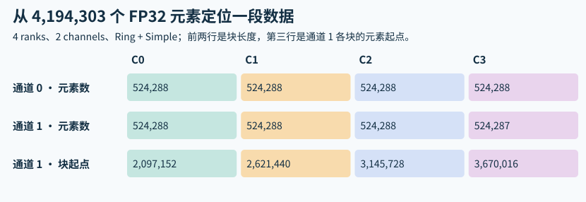
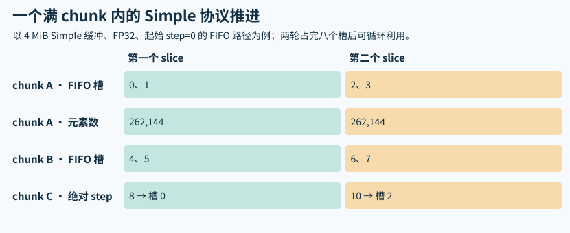

# 一次 AllReduce 究竟切几层？

假设四个 rank 都各自持有一份同长度的 FP32 数组，调用 `ncclAllReduce(..., ncclSum, ...)`。对每个下标 i，四个输出都应得到四个输入在 i 处的和。实现可以把不同下标分给不同 channel 并行处理。下面沿 **普通多 rank、Ring、Simple、CBD 调度** 这条实际路径追踪一个下标。CBD 是设备 work 注释中的 continuous-byte-distribution，表示把连续区间分给通道。

## 哪些层切数组，哪些量管进度

|观察层次|谁产生或决定|消耗者|怎样定位|
|---|---|---|---|
|① rank 的用户数组|`ncclAllReduce` 的 `sendbuff, recvbuff, count, datatype`|`ncclAllReduceConfigImpl → ncclInfo → task`|每个 rank 的有效区间均为 `[0,count)`，FP32 的末地址为基址加 `4 × count`|
|② channel 连续段|Host 的 `ncclComputeCollChannelLayout` 分 cell，调度器写 `work->cbd`|GPU 的 `ncclCollCbdPart`|以元素表示的 `[gridOffset, gridOffset+channelCount)`。多个 channel 可处理不同段|
|③ channel 内的一圈 loop|`runRing` 设 `loopCount = nranks × chunkCount`|外层循环推进 `elemOffset`|起点 `gridOffset + elemOffset`。loop 是索引范围，可跨多轮重复|
|④ 本圈的 rank chunk|环位置、原语阶段及 `chunkCount`|`directSend` 等原语|起点 `gridOffset + elemOffset + chunk × chunkCount`，长度按剩余量裁剪；同一块在多个 rank 间传递|
|⑤ 原语内的 slice|`ProtoSimple<SlicePerChunk,StepPerSlice>` 与本次 `nelem`|`genericOp → waitPeer / 数据处理 / postPeer`|在 chunk 起点上再加 slice 局部 `offset`，只搬运该 slice 的有效元素|

**按上述读法有五层，包括原始数组。** cell 是 Host 算通道边界的分配粒度；grain 是 work 编码 chunk 的计量单位；step 是连接同步与循环缓冲的计数单位。它们分别回答“怎么分给 channel”“如何编码长度”“什么时候允许读写”。跨机 IB 还可以把一次网络请求分给多个 QP，见[网络路径](04-transport.md)。源码入口见 [API](../../src/collectives.cc#L192)、[Host 调度](../../src/enqueue/enqueue.cc#L658)、[GPU 解码](../../src/include/device.h#L313)、[Ring](../../src/device/all_reduce.h#L14)、[Simple 原语](../../src/device/prims_simple.h#L179)。

## Host 先按流量分 cell，再把元素数写进 work

1. 对普通 FP32 AllReduce，`task->count` 沿用用户元素数，`elementSize=4`。调度中 `trafficPerByte=2`，估算流量为 `count × 4 × 2`。这个权重服务于负载均衡，线上传了多少字节还取决于算法、rank 数和传输路径。LL 在这里另有四倍权重。
2. 对同一类任务，`trafficBytes[kind]` 汇总计划中的估算负载，单 task 至少按 32 KiB 计入。`trafficPerChannel` 将汇总负载除以该类预算通道数，再向上对齐 16。若同一通道已经接过前一个任务，`currentTraffic` 会减少它还能接纳的 cell。
3. `cellSize = alignUp(ceil(32768 / trafficPerByte), 16)` 字节。`elementsPerCell = cellSize / elementSize`，`cells = ceil(count × elementSize / cellSize)`。先给首通道放能容纳的 cell，再分给中间和末通道。最后一条可用通道可接下全部剩余量；超出通道上限时会重算中间通道份额。
4. 首通道没有空间可前移 `channelOffset`。算法把完整的最后一段也编码为 Hi，并从最后非空段扣掉最后一个 cell 的填充。只有一个通道时全部放在 Lo。
5. `channelLo..channelHi` 包含两端。若通道数至少为二，令 `m = channelHi-channelLo-1`，则 `countLo + m × countMid + countHi = task->count`。中间每条都有 `countMid` 个元素。首段从 0 起，中间第 j 段（j 从 0 起）从 `countLo + j × countMid` 起，末段从 `countLo + m × countMid` 起。单通道时 GPU 先匹配 Lo，返回偏移 0。

[32 KiB 常量](../../src/include/channel.h#L21) · [流量权重和完整分配公式](../../src/channel.cc#L17) · [写入设备与代理描述符](../../src/enqueue/enqueue.cc#L755) · [读取三个区间](../../src/include/device.h#L313)

## 一组能从头算到地址的数

**输入假设**为单任务、4 ranks、`count=4,194,303` 个 FP32、从 channel 0 开始、两条通道预算、无历史负载、Simple 连接缓冲 4 MiB、无 tuner 覆盖、普通 Ring FIFO 路径。两通道是给定的调度输入。在不同机器上，调优器可能选不同通道数或协议。

|计算位置|代入|结果|
|---|---|---|
|应用和调度|每 rank 数据 `4,194,303 × 4`，调度负载再乘 2|16,777,212 B 数据；33,554,424 B 估算负载|
|channel 配额|每通道预算对齐到 16 B；一个 cell 含 16,384 B 数据、32,768 B 负载|16,777,216 B 负载/通道；共 1,024 cells，各分 512|
|去填充|每 cell 有 4,096 个 FP32，最后少 1 个 FP32|通道 0 为 `[0, 2097152)`，通道 1 为 `[2097152, 4194303)`|
|Host chunk|4 MiB / 8 = 524,288 B/step；每 chunk 4 steps|2,097,152 B/chunk；Simple grain 为 512 B，故写入 4,096 grains|
|Device chunk/loop|4,096 × (512/4)；再乘 4 ranks|524,288 元素/chunk；2,097,152 元素/满圈|
|通道 1 的尾圈|2,097,151 除 4 向上取整，按 16 B 即 4 个 FP32 对齐|块步长仍为 524,288，C3 只剩 524,287 个元素|
|通道 1 的 C3|起点 `2,097,152 + 0 + 3 × 524,288`|元素区间 `[3670016,4194303)`；字节区间 `[14680064,16777212)`|
|C3 的两个 slice|名义 262,144 个 FP32/片，裁掉最后一个元素|第一片 262,144，第二片 262,143；第二片起点为元素 3,932,160|

因此当环位置 0 在通道 1 首次调用 `directSend`，可在断点核对 `chunk=3, offset=3670016, nelem=524287`。offset 在每个 rank 自己的缓冲区中解释。两个 rank 的同一下标指向各自对应的逻辑数据。

## 如果首、中、末三个字段都有值

仍取 FP32 AllReduce 的 4,096 元素/cell。给布局函数传入 53,247 个元素（13 个 cell 少 1 个元素）、每通道 131,072 B 流量预算、当前通道已占 65,536 B，起始 channelId=2、maxChannels=6。每通道通常可接 4 个 cell；channel 2 只余 2 个 cell 的空间。因此 Host 写入 **Lo=8,192、Mid=16,384、Hi=12,287**，Mid 有两条。GPU 得到如下半开区间。[布局函数](../../src/channel.cc#L34) · [三个解码分支](../../src/include/device.h#L323)

|实际 channelId|使用的字段|本 rank 缓冲区内的元素范围|
|---|---|---|
|2|countLo|[0, 8192)|
|3|countMid，mid=0|[8192, 24576)|
|4|countMid，mid=1|[24576, 40960)|
|5|countHi|[40960, 53247)|

这里 channel 4 的起点是 Lo 和第一段 Mid 之和。仅凭 channelId 乘固定 chunkSize 会算错。复现程序也逐项调用 Host 分配和 GPU 共用的解码函数验证这些边界。

## 小消息、尾块和空 slice

同样 4 ranks、FP32，只剩 19 个元素时，按 4 个 rank 向上均分得 5，再按 4 个 FP32 向上对齐，**尾 chunk 步长变成 8**。四个候选起点为 0、8、16、24，实际长度为 8、8、3、0。最后一个候选的 `remCount - chunkOffset = -5`，Ring 中的带符号 `nelem` 可能暂为负值；Simple 的 `genericOp` 在使用前将其钳到 0。空片仍参与协议规定的握手。单 rank 和零元素在默认排队路径更早分流。源码见 [Ring 尾圈](../../src/device/all_reduce.h#L33)、[16 B 对齐](../../src/include/coll_sizes.h#L137)、[有效长度与空 slice](../../src/device/prims_simple.h#L185)、[API 分流](../../src/enqueue/enqueue.cc#L3421)。

## 容易混用的变量

|变量|单位与作用域|赋给谁／怎么用|
|---|---|---|
|`count`、`datatype`、`elementSize`|API 元素数、类型、B/元素|AllReduce 保留归约类型；普通任务中的 AllGather、Broadcast 会转成 int8 并相应放大 count|
|`nRanks`、`rank`、`ringIx`、`userRanks[]`|组规模、全局编号、环坐标、环位置到全局编号的表|`setupChannel` 计算以全局 rank 0 为起点的 index，并把 userRanks 旋转到本地 rank 开头|
|`kind`、`nMaxChannels`、`trafficBytes`|任务类别、通道上限、估算流量 B|调度器先按 CollNet/NVLS 类别汇总，再按该类预算求 trafficPerChannel|
|`channelId`、`channelLo/Hi`、`channelMask`|通道编号、闭区间、计划位图|GPU 将 blockIdx.x 对应到位图中第几个置位，实际通道编号可不同于 block 编号|
|`countLo/Mid/Hi`、`gridOffset`、`channelCount`|内部 T 元素|Host 三种段长经 ncclCollCbdPart 解成当前通道的起点和长度|
|`chunkSize`、`chunkGrainsLo/Mid/Hi`、`chunkCount`|Host 字节、work 中的 grain 个数、GPU 元素|编码：chunkSize/grainSize；解码：grains × (grainSize/sizeof(T))。尾圈可能重新写局部 chunkCount|
|`loopCount`、`elemOffset`、`remCount`|当前 channel 的元素数尺度|名义圈跨度、当前圈相对起点、尚待处理量；外层循环使用进入循环前算出的 loopCount|
|`chunk`、`chunkOffset`、`offset`、`nelem`|块编号、圈内元素偏移、全数组元素偏移、本次有效元素数|块编号依环阶段变化，chunkOffset=chunk×chunkCount，三段偏移求和传给原语|
|`chunkSteps`、`sliceSteps`、`SlicePerChunk`、`StepPerSlice`|协议步数或片数|本例 Host 为 4、2，GPU 模板为 2、2；即 2 slices/chunk、2 steps/slice|
|`stepSize`、`connStepSize`、`sliceSize`|Host stepSize 为 B，Simple GPU 侧的三个局部长度为元素|设备默认 stepSize=buffSizes/8/sizeof(T)，连接槽地址用 connStepSize；动态 sliceSize 还被剩余元素数裁剪|
|`step`、`connStepCache`、`head/tail`|连接累计同步进度|等待角色检查对端缓存进度，发布角色更新进度；在常规 FIFO 地址分支，槽下标为 step % NCCL_STEPS|
|`nstepsPerLoop`、`nchunksPerLoop`、`proxyOp->nsteps`|算法链路推进次数、块个数、代理协议步数|RingTwice 是 2(R−1)、R；普通 Host 公式为 2(R−1) × nLoops × chunkSteps，后续注册或特化路径可覆盖|

Simple 的动态片长公式为 `max(ceil(nelem/(16×SlicePerChunk))×16, nominalSliceElements/32)`，再在每片执行时裁到剩余长度。这里的 16 以元素为单位；Ring 尾块的对齐参数 16 以字节为单位。直接访问 peer 缓冲或已注册 NET 缓冲时要看指针选择分支，用户数据可能绕开常规 FIFO 数据区。[Simple 模板实参](../../src/device/all_reduce.h#L231) · [片长公式](../../src/include/coll_sizes.h#L129) · [direct 与 FIFO 指针选择](../../src/device/prims_simple.h#L104) · [代理步数](../../src/enqueue/enqueue.cc#L2482)
