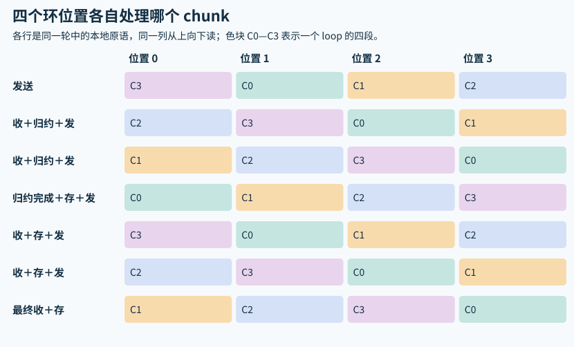
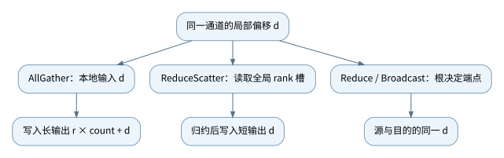
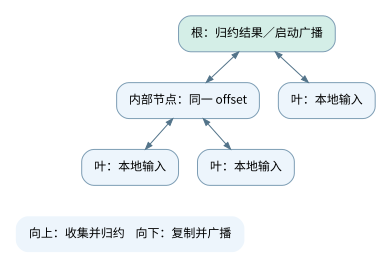

# 五种 Ring 如何读写缓冲区

设环顺序 `0 → 1 → 2 → 3 → 0`，每个位置同时从 prev 收、向 next 发。实际顺序由每个 channel 的拓扑决定。初始化以 rank 0 为参照计算 `ring->index`，同时生成以本 rank 开头的 `ring->userRanks[]`。例如环为 `0 → 2 → 1 → 3 → 0` 时，全局 rank 2 的环位置是 1，它看到的 userRanks 为 [2,1,3,0]。下图列名均为**环位置**。[环顺序初始化](../../src/init.cc#L989)

## AllReduce 的七次原语与六轮传输

用 C0…C3 表示当前 channel、当前 loop 的四个连续区间。以位置 0 为例，追踪本 GPU 的输入、接收和输出。

|该位置的原语顺序|块|数据从哪里来、到哪里去|
|---|---|---|
|directSend|C3|取本地输入 C3，发向位置 1|
|directRecvReduceDirectSend|C2|从位置 3 收到其输入，和本地输入 C2 相加，发给 1|
|directRecvReduceDirectSend|C1|收到包含位置 2、3 的部分和，再加本地 C1，发给 1|
|directRecvReduceCopyDirectSend|C0|收到位置 1、2、3 的部分和，加本地 C0；执行 postOp、写本地输出并立即转发|
|directRecvCopyDirectSend|C3|收到完整 C3，写本地输出并转发|
|directRecvCopyDirectSend|C2|收到完整 C2，写本地输出并转发|
|directRecv|C1|收到最后一块 C1，写回本地输出|

同一块 **C0** 的归约路线为 1 发、2 加、3 加、0 加并存，分发路线为 0 发、1 存并发、2 存并发、3 存。图中各行是本地调用次序，邻居前一个调用发出的数据供后一个调用接收。完成归约和首次分发在同一原语融合，所以四个 rank 的本地原语调用为 7 次，单条边发出 6 份 chunk 数据。对一般 R≥2，发送次数为 `2 × (R−1)`。源码中的 `modRanks` 只需减一次 R，因为调用处保证入参范围。环跨多圈时，原语顺序重复而 `elemOffset` 已前移。[runRing](../../src/device/all_reduce.h#L14) · [RingTwice 的代理配置](../../src/enqueue/enqueue.cc#L2467)

以整数求和检验输出：若 rank r 输入的第 i 个值为 `100r+i`，则四个 rank 输出的第 i 项均为 `600+4i`。分块改变的是传输顺序，元素 i 的所有贡献最终仍在同一 i 上归约。

## 同一条环上，五种操作的地址有什么差别

表中 R 为 rank 数，c 是每 rank 的 API count，d 是本通道正在处理的段内偏移。AllGather 等无算术归约的常规任务会将 c 与 d 一起归一到字节；公式两侧必须使用同一单位。

|操作|每 rank 的有效输入 → 输出|块如何经过节点|源码|
|---|---|---|---|
|AllReduce|c → c|每圈按环位置分 R 个 chunk。负责位置得到最终归约块后写回并转发，所有输出都有全部块|[all_reduce.h](../../src/device/all_reduce.h#L33)|
|AllGather|c → R×c|起点读本地 d。目的槽取全局 rank r，写 `r×c+d`。原地时本地贡献已在正确槽，只需发；非原地普通路径还复制自己的段|[all_gather.h](../../src/device/all_gather.h#L46)|
|ReduceScatter|R×c → c|每一跳从本地长输入的 `rankDest×c+d` 取对应贡献；最后本 rank 把完整归约写进短输出 d|[reduce_scatter.h](../../src/device/reduce_scatter.h#L34)|
|Broadcast|root c → 全部 rank 各 c|root 从源缓冲开始发，各中间节点复制转发；`nextRank==root` 的节点收下最后一跳|[broadcast.h](../../src/device/broadcast.h#L39)|
|Reduce|各 c → root c|root 之后的节点首先发送，中间节点接收、归约并转发，root 的 recvReduceCopy 结束链条并写结果|[reduce.h](../../src/device/reduce.h#L34)|

例如两个 rank 的 AllGather 输入分别为 [10,11] 和 [20,21]，两个输出都是 [10,11,20,21]。ReduceScatter(sum) 若输入分别为 [1,2,3,4]、[10,20,30,40] 且 recvcount=2，rank 0 得 [11,22]，rank 1 得 [33,44]。全局 rank 槽决定 API 可见的顺序，即使设备上的实际环被重排也是如此。

## 哪些路径要换读法

|算法／协议|仍可沿用的量|需要重新定位的部分|
|---|---|---|
|Tree AllReduce|通道起点、段长、chunk 的有效元素|普通树按同一 offset 发往父节点，根汇总后向子节点广播；runTreeUpDown 先后执行两段，runTreeSplit 可给上下行分不同线程组。[Tree 特化和条件](../../src/device/all_reduce.h#L235)|
|PAT AllGather / ReduceScatter|普通路径也解码 CBD|PatAGAlgorithm / PatRSAlgorithm 的 getNextOp 产生步骤；检查 one-RPN 与 multi-RPN 分支及其 worker。一次 PAT 步的伙伴和偏移取决于步骤描述。[AG](../../src/device/all_gather.h#L117) · [RS](../../src/device/reduce_scatter.h#L80)|
|NVLS / NVLS_TREE AllReduce|仍需定位本通道处理的元素|块归属涉及 nHeads、headRank，设备分 scatter、gather、reduce、broadcast 等工作。NVLS_TREE 用 nHeads×chunkCount 推进圈。[NVLS](../../src/device/all_reduce.h#L402) · [NVLS_TREE](../../src/device/all_reduce.h#L527)|
|CollNet Direct / Chain|Host 同样选 chunk 和协议|Host 写 work->collnet.count/chunkCount；读者应按设备特化跟踪 head、通道、布局。CBD 和 collnet 是 union 的不同成员。[Host](../../src/enqueue/enqueue.cc#L722) · [Direct](../../src/device/all_reduce.h#L263) · [Chain](../../src/device/all_reduce.h#L638)|
|LL / LL128 Ring|仍有环位置、channel 区间和逻辑 chunk|设备模板分别走 LLGenericOp、GenericOp。LL 16 B 行含 8 B 数据，LL128 128 B 行含 120 B 数据；Host 在计算可用 chunk 时扣除标志开销。Simple 的两片、每片两步仅用于相应 Simple 特化。[容量计算](../../src/include/coll_sizes.h#L115) · [LL](../../src/device/prims_ll.h#L239) · [LL128](../../src/device/prims_ll128.h#L297)|

同一 API 还有选路条件。例如普通 Broadcast 可被批量广播优化收进 AllGatherV 队列，NET 注册且 one-RPN 的 Ring AllGather 可以采用大 chunk 并分工进行本地复制。读性能日志时要先确认实际落到哪条实现。[Broadcast 建任务](../../src/enqueue/enqueue.cc#L2849) · [注册 AllGather 的代理覆盖](../../src/enqueue/enqueue.cc#L2534)
