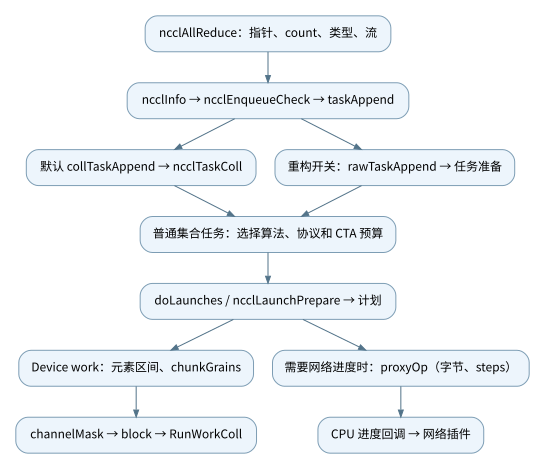

# 从 communicator 初始化到 GPU 拿到 work

## 初始化如何决定谁和谁相连

|顺序|源码对象与动作|留给下一阶段的数据|
|---|---|---|
|发现设备与路径|initTransportsRank 读取拓扑，求路径，清理后再求一次；bootstrap 负责 rank 之间交换初始化信息|comm->topo 描述可用 GPU、CPU、网卡等节点及相互路径。[init.cc](../../src/init.cc#L1450) · [bootstrap.cc](../../src/bootstrap.cc)|
|搜索算法图|分别调用 ncclTopoCompute 生成 Ring、Tree 和具备条件的其他算法图。搜索沿候选路径递归并受可用带宽、通道约束等影响|每类图保存候选通道及局部顺序。后面的消息调优还要考虑具体集合类型和长度。[搜索](../../src/graph/search.cc#L1245) · [调用点](../../src/init.cc#L1487)|
|汇总并拼接|ncclTopoPreset 填写局部 topoRanks，跨 rank 交换后 ncclTopoPostset 拼环／树，ncclBuildRings 检查环|setupChannel 将全局环序重排为当前 rank 可用的 index、userRanks 和 rankToIndex。[拼接](../../src/graph/connect.cc#L395) · [成环](../../src/graph/rings.cc#L29) · [本地视图](../../src/init.cc#L989)|
|连接相邻 peer|selectTransport 由 channelId、peer、方向和 connIndex 取 connector，枚举运输实现，通过 canConnect 后调用 setup；其余握手在 transport 层完成|peer 对应的连接信息包含同步位置、缓冲与能力标志；支持运行时建连时也可在组执行前按需补连。[选择](../../src/transport.cc#L23) · [组内预连接](../../src/group.cc#L823)|

## 一次 AllReduce 的对象交接

1. **调用线程。** ncclAllReduceConfigImpl 将用户指针、count、datatype、stream、op 和默认 chunkSteps/sliceSteps 写入栈上的 ncclInfo。ncclEnqueueCheck 进入内部 group，再调用 taskAppend。默认路径复制归约操作的设备表示，对单 rank 提前处理，对普通多 rank 建立集合任务。[API](../../src/collectives.cc#L192) · [排队](../../src/enqueue/enqueue.cc#L3570) · [任务分流](../../src/enqueue/enqueue.cc#L3417)
2. **选算法和 block 预算。** 准备阶段构建可聚合任务的输入，由 ncclGetAlgoInfo 调 ncclTuningCompute，写回 algorithm、protocol、nWarps 和有效的 maxChannels。拓扑、数据量、能力、配置和可选 tuner 都可能影响选择。按通道的具体元素数要继续追到 scheduleCollTasksToPlan。[调优调用](../../src/enqueue/enqueue.cc#L528) · [参数写回](../../src/enqueue/enqueue.cc#L2282)
3. **打包。** ncclLaunchPrepare 可以为同组工作生成多个 ncclKernelPlan。普通集合任务由 scheduleCollTasksToPlan 写 devWork、为对应 channel 加入 work batch，并按需要安排 proxyOp。finishPlan 组织参数和批次；较大 work 有独立的存储路径。[设备 work 和代理](../../src/enqueue/enqueue.cc#L825) · [计划准备](../../src/enqueue/enqueue.cc#L1755) · [finishPlan](../../src/enqueue/enqueue.cc#L245)
4. **GPU 执行。** doLaunches 按计划调用 ncclLaunchKernel。ncclKernelMain 根据 channelMask 将 blockIdx.x 映射到实际 channelId，加载 work batch 到共享内存，再选择对应函数；RunWorkColl 的模板参数决定执行 Ring、Tree 等实现。若位图仅 1、3 两位置位，block 0 和 1 分别处理 channel 1 和 3。[launch](../../src/group.cc#L476) · [位图与分派](../../src/device/common.h#L420) · [调用特化](../../src/device/common.h#L333)
5. **CPU Proxy。** 对需要网络推进的操作，计划保存每通道的 proxy 描述。GPU 原语和代理通过 FIFO 的数据、进度和标志配合。进度线程执行 transport 回调，NET 传输可以进一步走 IB 或其他已选网络插件。[代理保存与启动](../../src/enqueue/enqueue.cc#L1579) · [进度线程](../../src/proxy.cc#L956) · [NET/IB](04-transport.md)

## 在调试器里查哪个对象

|对象|生命周期和关键字段|怎样用它定位问题|
|---|---|---|
|ncclComm / ncclChannel|communicator 跨多次调用存在；channels 描述环、树、peer 和连接，部分资源可在 comm 间共享|先核对 rank、nRanks、拓扑及 send/recv 方向，再查此次 plan 选了哪几条 channel。[通道初始化](../../src/channel.cc#L82)|
|ncclInfo → ncclTaskColl|一次 API 的临时输入被复制成待调度任务；count/类型可能归一化，算法、协议、注册状态稍后补齐|先看用户单位，再看 task->datatype 和 task->count。[任务填充](../../src/enqueue/enqueue.cc#L2878)|
|ncclKernelPlan → ncclDevWorkColl|计划持有本轮 launch 的批次信息；work 含缓冲、root、channelLo/Hi、nWarps 和 cbd/collnet 联合体|在 Host 写入后和 Device 解码前对照同一组字段。[work 定义](../../src/include/device.h#L263)|
|ncclProxyOp → ncclProxySubArgs|op 携带 channel、chunk、协议、步数；进度中的 sub 保存请求、缓冲、posted/transmitted/done 等|比较相邻两个计数及对应 request 是否已创建或完成。[代理结构](../../src/include/proxy.h#L73)|
|ncclConnInfo|每方向连接的设备侧视图含缓冲、head/tail 和 step|定位卡在等待数据、等待空间还是等待网络完成。[连接结构](../../src/include/device.h#L104)|

**本版还有重构入口。** NCCL_ENQUEUE_REARCH_ENABLE 在此基线默认 0。启用后 rawTaskQueue 先做 pre-tuning、适用任务的 tuning、classification、post-tuning；group 的 raw-task 分支仍调用 doLaunches。定位代码时要同时看开关与实际调用点，避免把 task_sched 中注释掉的调度顺序当作运行记录。[开关](../../src/enqueue/enqueue.cc#L35) · [准备阶段](../../src/enqueue/task_prep/task_prep.cc#L11) · [实际 launch](../../src/group.cc#L1004)
