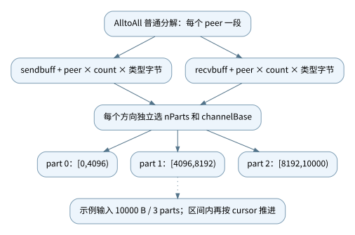
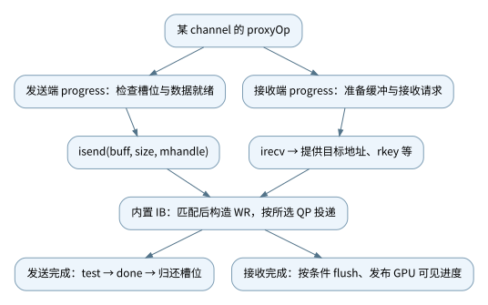
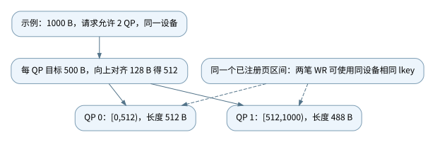

# 从用户张量到 peer、NET 请求与 IB QP

## Send/Recv 及普通 AlltoAll 的分区

普通 AlltoAll 的 API count 表示**给每个 peer 的元素数**。在 taskAppend 的 P2P 展开分支中，对每个 r 生成一个 send 和一个 recv。发送地址为 `sendbuff + r×count×typeSize`（按字节相加），接收地址同样从 recvbuff 的第 r 段开始。在 rank a 上发送段 b 对应 rank b 的接收段 a。例如三 rank、每段两个 int32，rank 2 给 rank 1 发送本地字节 [8,16)，目标是 rank 1 接收缓冲中的 [16,24)。这是普通展开路径；强制的对称 AlltoAll kernel 另有可用性检查。[AlltoAll 展开](../../src/enqueue/enqueue.cc#L3483)

|分区|变量、单位与生产者|消费者及边界|
|---|---|---|
|单向 peer 消息|sendBytes/recvBytes 为字节；peer 可以不同。scheduleP2pTasksToPlan 配对该轮任务，addP2pToPlan 给每个方向安排通道|ncclDevWorkP2p 独立保存 send/recv 地址、长度、目标和通道数。[Host](../../src/enqueue/enqueue.cc#L974) · [设备描述](../../src/include/device.h#L220)|
|消息 → 通道 part|nParts 取对应方向的 nSendChannels 或 nRecvChannels。channelBase 与总 P2P 通道数定义 part 到 channel 的循环映射|part=(channelId−channelBase) & (nP2pChannels−1)；仅 part<nParts 的方向有工作。partBytes=alignUp(ceil(bytes/nParts),4096)，首尾都裁到 bytes。[映射](../../src/include/device.h#L239) · [应用到指针和长度](../../src/device/sendrecv.h#L75)|
|part → 单次收发|以字节 cursor 从 part 起点向后推进，每次取 min(chunkSize,bytes−cursor)|普通路径解码 u32fp8 字段，大块注册路径按条件用 NCCL_MAX_NET_SIZE；读写两个方向各自的设置。[runSend / runRecv](../../src/device/sendrecv.h#L17)|

图中的 10,000 B/3 parts 是给区间辅助函数的示例输入。partBytes=4,096，所以最后一份是 1,808 B。如果分配的 part 比有效页更多，末端可能得到空区间。

## 什么时候进入 CPU Proxy

selectTransport 会检查 P2P、SHM、NET 等连接能力。即使两个 rank 运行同一个 Ring，具体边也可能采用不同的 transport。下面跟踪选中 NET、内置 IB 插件、常规 CPU 代理推进的边。

1. **GPU / 发送代理。** Simple 原语在连接上发布槽位和有效长度。sendProxyProgress 根据协议、共享缓冲及注册状态获得 buff、size 和 sendMhandle，就绪后调用 ncclNet->isend。请求指针有效才递增 transmitted，增量为 sliceSteps。后面 test 完成才推进 done 并回收槽。[发送进度](../../src/transport/net.cc#L1327) · [isend 与 test](../../src/transport/net.cc#L1440)
2. **接收代理。** recvProxyProgress 管理可接收空间、irecv 请求、完成检测、必要的 flush 及向 GPU 发布进度。查看每一步是按什么条件从 posted 移到 received、transmitted、done，有助于区分“网卡已收”和“GPU 已消费”。[接收进度](../../src/transport/net.cc#L1496)
3. **NET 插件。** ncclNetIb 表将 isend、irecv、regMr、test 等函数指针绑定到本版实现。IB 端匹配接收方提供的远端地址、key 等信息后，可以在一个或多个 QP 上构造 WR 并投递；完成由请求状态和 CQ 事件跟踪。[接口表](../../src/transport/net_ib/common.cc#L244) · [批发送](../../src/transport/net_ib/p2p.cc#L83) · [CQ](../../src/transport/net_ib/p2p.cc#L956)

## 从一个网络请求再切到多个 QP

|量|含义|由谁决定、流向哪里|
|---|---|---|
|nQpsPerDev、vProps.ndevs|每个底层设备期望的 QP 数；逻辑设备包含的物理设备数|连接建立时计算 localNqps、remoteNqps，取较大值写 base.nqps；base.nDataQps 取两端物理设备数较大者。[协商](../../src/transport/net_ib/connect.cc#L966)|
|base.nqps、nDataQps、splitDataOnQps|连接已建的数据 QP 规模、按设备并行的数量、是否用全部 QP 分摊一个请求|GetNqpsPerRequest 在 splitDataOnQps==1 时返回 nqps，否则返回 nDataQps。随后按请求和局部序号选具体 QP。[请求选择](../../src/transport/net_ib/common.h#L450)|
|weights、qpsPerDev、sendOffsets|原设备的带宽权重、该设备分摊的请求 QP 数、当前请求已分派字节数|每 QP 计划长度按权重和数量计算，向上对齐 128 B，再裁到剩余字节。同设备同权且两条 QP 的 1,000 B 请求先发 512 B，再发 488 B。[实际切分](../../src/transport/net_ib/p2p.cc#L179)|
|lkey、rkey、mhandle|本地 SGE 的访问 key、远端目标区间的 key、网络插件的注册句柄|发送选择适用设备的 key。一个已注册区间可以服务多个 slice、多个请求和多条 QP。[WR 设置](../../src/transport/net_ib/p2p.cc#L175)|
|mrCache、addr、pages、refs|按物理设备查找已注册的页区间；命中后增加引用计数|未命中时才调用实际注册 API。fd、设备能力、relaxed ordering 影响所走的注册分支。[注册与复用](../../src/transport/net_ib/reg.cc#L10)|

因此增加 NCCL_IB_QPS_PER_CONNECTION，直接影响的是连接的 QP 配置。相同设备上重复使用已注册缓冲时，MR 缓存仍可命中。完整资源预算另外取决于实际 NET 连接、共享方式、缓冲、设备数以及按需创建的 flush QP。源码能计算单次分段并找到资源的分配点；网线上实际包数还受设备、MTU 和重传等因素影响。[创建数据 QP](../../src/transport/net_ib/connect.cc#L725) · [按需 flush QP](../../src/transport/net_ib/connect.cc#L1382)
