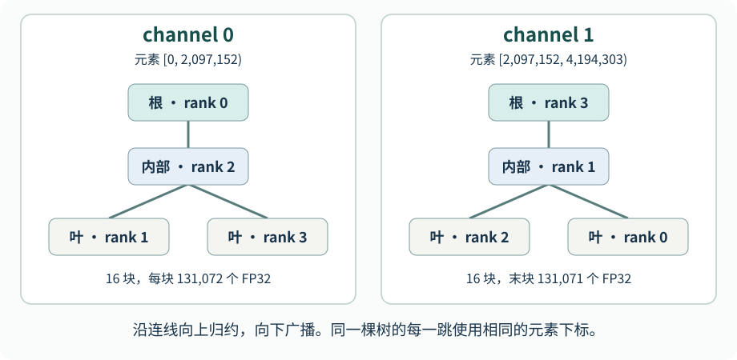

# Tree AllReduce：四个 rank 怎样处理同一个下标

沿用[上一章的 Ring 算例](01-data-layout.md)：四个 rank 各有 4,194,303 个 FP32，做 sum。固定普通 CBD 调度、两个工作通道、各通道原先为空、Simple 缓冲 4 MiB，无 tuner 覆盖。本章把算法改为普通 Tree。为了从源码算出具体父子编号，再指定四个节点、每节点一个 rank，节点号等于 rank 号，建树时有一条原始通道及其配对副本，两棵树用于本次 work。这是可复算的输入，实际机器可从初始化日志核对自己的树。[建树日志的字段顺序](../../src/graph/connect.cc#L181)

**从一个元素看**，channel 决定它属于哪棵树，chunk 决定它随哪批元素传输。该树上的四个 rank 都贡献本地下标相同的值。叶子向上发送，内部节点把自己的输入加到子树部分和，根加上自己的值并启动广播。最终每个 rank 都在自己的 recvbuff 的原下标得到同一结果。[Tree 设备循环](../../src/device/all_reduce.h#L146)

## 父子关系从哪里来

节点内，ncclTopoPreset 按图搜索得到的 treeIntra 顺序写 channel->tree.up 和 down[0]。节点间，connectTrees 调用 ncclGetDtree(nNodes, node, ...)，得到两套**节点编号**。当节点数为偶数，第二棵树镜像第一棵；为奇数时采用循环平移。connectTrees 再通过各节点上报的入口 rank，把父子**节点号**换成实际对端 **rank 号**，分别填入 channel c 和 c+nChannels。setTreeDown 忽略 -1，并把有效孩子紧凑地放进 down[]。初始化将每通道的 tree 复制到设备描述，kernel 再把选中通道载入共享内存。因此 tree->up == -1 表示本通道的根；对非根，down[0] == -1 表示叶子。每节点多卡时，还要叠加本地链，不能直接拿下面的四行套用。[本地链与复制](../../src/graph/connect.cc#L50) · [双树算法](../../src/graph/trees.cc#L90) · [连接到 rank](../../src/graph/connect.cc#L130) · [复制到设备](../../src/init.cc#L835) · [装载当前通道](../../src/device/common.h#L460)

|本地 rank|channel 0 父 / 有效孩子|channel 1 父 / 有效孩子|
|---|---|---|
|0|无 / 2|1 / 无|
|1|2 / 无|3 / 2、0|
|2|0 / 1、3|1 / 无|
|3|2 / 无|无 / 1|

## 数组切几层，每个变量管哪一层

按上一章把用户数组计入第一层的口径，Tree + Simple 可以读成**用户数组 → channel 连续段 → chunk → Simple slice**。本例一个 chunk 只有一个 slice，两者的有效区间重合。根、内部节点、叶子描述同一 chunk 经过的节点。每深入一层树，元素范围保持一致。Ring 的一圈还会按环位置选择不同 rank chunk，Tree 的循环直接按 chunkCount 向后移。[Ring 循环](../../src/device/all_reduce.h#L33) · [Tree 根及两组线程的循环](../../src/device/all_reduce.h#L166)

|变量（单位）|产生处|谁用它，怎样影响区间|
|---|---|---|
|countLo/Mid/Hi（元素）|Host 的 ncclComputeCollChannelLayout|各通道解出 gridOffset 和 channelCount。双通道例中为 Lo=2,097,152，Hi=2,097,151，分别从 0、2,097,152 开始|
|stepSize、chunkSize（Host 字节），chunkSteps、sliceSteps（协议步）|calcCollChunking 从 buffSizes[Simple]/NCCL_STEPS 得到 524,288 B/step；普通 Tree 的步数助手均返回 1|名义 chunkSize=524,288 B。本例 Simple Ring 则用 4 steps/chunk，得到 2,097,152 B|
|chunkGrainsLo/Hi（grain 数）、chunkCount（元素）|Host 按段将 chunkSize 除以 512 B 得 1,024 grains；设备用 ncclCollCbdPart 解码|每 grain 放 512/4=128 个 FP32，每次循环前进 1,024×128=131,072 个元素|
|elemOffset、offset、nelem（元素）|每个阶段的 for 循环从 elemOffset=0 开始，每次加 chunkCount|offset=gridOffset+elemOffset；nelem=min(chunkCount,channelCount-elemOffset)。传给收发原语的 offset 相对用户缓冲区起点|
|tree->up、tree->down[]（对端 rank）|建树时写每个 channel 的 ncclTree|上行从 down[] 收、向 up 发，下行从 up 收、向 down[] 发；根在自己的缓冲中完成归约|
|tid、nthreads、nthreadsSplit（线程编号 / 线程数）|Simple 的 runTreeSplit 在非根把线程分组|本例若 nthreads=512，前 320 个线程负责上行，后 192 个负责下行。两个线程组遍历同一个区间；group 参数分别为 0 和 Proto::MaxGroupWidth|
|SlicePerChunk、StepPerSlice（片数 / 步数）|Tree + Simple 选择 ProtoSimple&lt;1,1&gt;|每个原语只有一个协议 slice。genericOp 将名义片长裁到 nelem，有效元素最多为本次 chunk 的长度|

[Host 分配](../../src/channel.cc#L34) · [步数与 chunk 字节](../../src/include/coll_sizes.h#L103) · [Host 分段编码](../../src/enqueue/enqueue.cc#L791) · [设备解码](../../src/include/device.h#L313) · [线程数来源](../../src/device/common.h#L329) · [Simple 有效片长](../../src/device/prims_simple.h#L220)

## 同一份输入在 Ring 与 Tree 中落在哪个 chunk

|观察量|Ring + Simple|Tree + Simple|
|---|---:|---:|
|channel 1 的元素区间|[2,097,152, 4,194,303)|[2,097,152, 4,194,303)|
|名义 chunk 的 FP32 数|524,288|131,072|
|channel 1 的分块|一圈四个候选块，末块少一个元素|顺次 16 个 chunk，末块少一个元素|
|最后一个 chunk 的起点|3,670,016|4,063,232|
|最后一个 chunk 的有效元素|524,287|131,071|
|最后一个 chunk 的有效 slice 长度（FP32）|262,144 与 262,143|131,071|

上次 Ring 的 C3 覆盖 [3,670,016, 4,194,303)。同一区间在 Tree 中正好是 channel 1 的第 12、13、14、15 号 chunk（从 0 编号），前三个各 131,072 个元素，最后一个 131,071 个，共 524,287 个。Host 对 TreeUpDown 令 nchunksPerLoop 和 nstepsPerLoop 都为 1；这些是代理进度公式的量。四节点树仍有三条父子边。[Host 的模式与步数](../../src/enqueue/enqueue.cc#L2444) · [Ring 与 Tree 的特化](../../src/device/all_reduce.h#L228)

## 跟踪末尾一个下标，直到四份输出

取最后一个有效下标 **i=4,194,302**。它落在 channel 1 的 chunk 15：起点 2,097,152+15×131,072=4,063,232，局部下标 131,070。最后一个 FP32 的字节区间为 [16,777,208, 16,777,212)，在各自的 sendbuff/recvbuff 基址上解释。令四个 rank 在这个下标的输入依次为 1、2、4、8，下表取 runTreeSplit。

|阶段|执行节点与源码原语|对 i 做什么|
|---|---|---|
|叶向上发|rank 0 和 rank 2 各执行 directSend|各读本地 sendbuff[i]，将 1、4 交给父 rank 1|
|内部归约|rank 1 执行 directRecvReduceDirectSend|读两个孩子的贡献及本地输入 2，得到部分和 7 并发给 rank 3；该原语的本地目标缓冲模板参数为 -1|
|根归约并广播|rank 3 执行 directRecvReduceCopyDirectSend，doPost=true|接收 7，加入本地输入 8，写本地 recvbuff[i]=15，把结果发给 rank 1|
|内部下发|rank 1 执行 directRecvCopyDirectSend|收最终值 15，写本地 recvbuff[i]，同时转发给 rank 2、0|
|叶接收|rank 2 和 rank 0 各执行 directRecv|各自 recvbuff[i] 得到 15|

这五行描述一个数据依赖链。设备按整个 chunk 调原语，例中的 i 与同一 chunk 的其他元素一道处理。原语名中的 Direct 说明该实现具备相应直接访问路径；实际指针和物理传输由连接及注册状态决定。[叶子发送与接收](../../src/device/prims_simple.h#L948) · [内部节点广播](../../src/device/prims_simple.h#L978) · [内部归约和根融合原语](../../src/device/prims_simple.h#L1011)

## 分线程执行与先上后下，如何在源码区分

Tree + Simple 特化在编译条件 CUDART_VERSION >= 11020 且 < 11040 且 __CUDA_ARCH__ >= 800 时调用 runTreeUpDown，其他情况调用 runTreeSplit，两条路径都使用 ProtoSimple&lt;1,1&gt;。UpDown 的本地线程先完成上行循环，再进入下行循环。根的两个原语依次为 directRecvReduceCopy、directSendFromOutput，覆盖相同的通道区间。Split 的根由全部参与线程逐 chunk 完成融合原语；非根的两个线程组分别走上行和下行，可在依赖满足时推进不同 chunk。实际重叠时长取决于执行环境。[编译选择](../../src/device/all_reduce.h#L237) · [UpDown 两阶段](../../src/device/all_reduce.h#L86) · [Split 的线程分工](../../src/device/all_reduce.h#L146)

仓库根目录执行 `python3 tools/zh_walkthrough/verify.py` 可复算此例。CPU 校验取用建树、通道布局、chunk 换算以及两种 Tree 设备循环的源码函数体，核对两张父子表、每个角色的原语、双通道全部区间和末块长度。上表中的数值 1、2、4、8 和结果 15 是依据 sum 语义的逐元素算例。真实 GPU 并发、连接协议的内存可见性和跨机耗时需要在对应硬件上测量。
