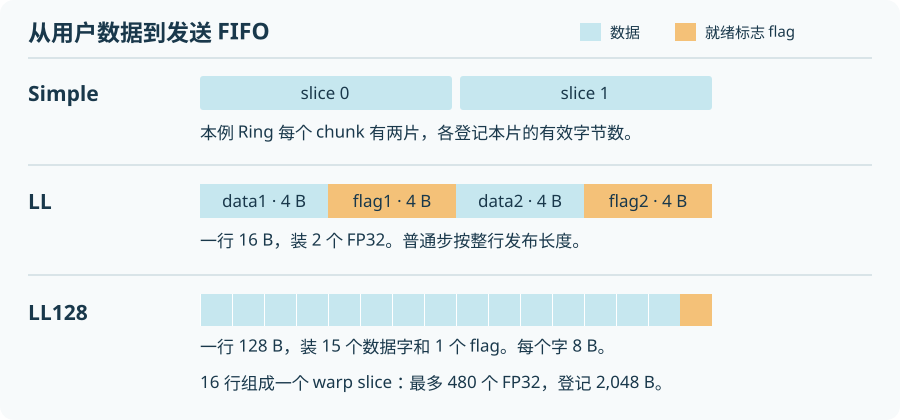

# Ring AllReduce 的同一个末尾元素怎样经过 Simple、LL 和 LL128

四个 rank 各有 4,194,303 个 FP32，做 sum。观察最后一个下标 **i = 4,194,302**。沿用[双通道 Ring 算例](01-data-layout.md)，让同一个操作分别走三种协议。三者共用 `runRing`。协议决定一圈能处理多少用户元素，以及一次发送要向连接 FIFO 发布多少字节。下面的地址均为半开区间，B 表示字节。[Ring 三种设备特化](../../src/device/all_reduce.h#L228) · [LL 和 LL128 入口](../../src/device/all_reduce.h#L763)

**算例条件。** 固定普通 CBD 调度、环顺序 0 → 1 → 2 → 3 → 0、两个工作通道、单任务、无历史负载。采用各协议自己的默认缓冲，无 chunk tuner 覆盖。比较发送长度时取普通 FIFO 路径、启用连接 FIFO 元数据、LL 处在普通发送步。协议是本例的输入，真实作业的选择可查初始化和 tuning 日志。[调优结果写回](../../src/enqueue/enqueue.cc#L2280) · [三个缓冲分别初始化](../../src/init.cc#L1008)

## 用户数组到 Ring chunk

|Host 或 Device 的中间量|Simple|LL|LL128|
|---|---:|---:|---:|
|连接缓冲 `buffSizes[protocol]`（B）|4,194,304|524,288|4,915,200|
|Host `stepSize = 缓冲 / 8`（B）|524,288|65,536|614,400|
|`chunkSteps / sliceSteps`（协议步）|4 / 2|1 / 1|1 / 1|
|`chunkSize`（用户数据 B）|2,097,152|32,768|576,000|
|`grainSize`（用户数据 B）|512|16|1,920|
|`chunkGrainsHi = chunkSize / grainSize`|4,096|2,048|300|
|`chunkCount`（每个名义 chunk 的 FP32 数）|524,288|8,192|144,000|
|`loopCount = 4 × chunkCount`（本通道每满圈的 FP32 数）|2,097,152|32,768|576,000|

1. **从缓冲到容量。** Simple 的一个 chunk 跨 4 step。LL 默认缓冲为 8 行/线程 × 512 线程 × 8 step × 16 B，一半存有效数据。LL128 默认缓冲为 120 个 64 位字/线程 × 640 线程 × 8 step × 8 B，每 16 个字有 15 个可存数据。这里的线程数是默认缓冲的尺寸参数，实际 work 的线程数另由调优选择。[初始化公式](../../src/init.cc#L1008) · [LL 行数](../../src/include/nccl_device/impl/ll__types.h#L29) · [LL 线程上限](../../src/include/device.h#L87) · [LL128 常量](../../src/include/nccl_device/impl/ll128__types.h#L13) · [步数与载荷计算](../../src/include/coll_sizes.h#L103)
2. **从 Host 到 Device。** Host 按 `grainSize` 向下对齐，再把每段的 chunk 编成 grain 数。设备用 `grain 数 × (grainSize / sizeof(T))` 解出 `chunkCount`。LL 的 16 B grain 按**用户数据**计，填满这个 grain 需要两条 16 B 的 LL FIFO 行。[Host 对齐](../../src/enqueue/enqueue.cc#L2442) · [写入 work](../../src/enqueue/enqueue.cc#L790) · [设备解码](../../src/include/device.h#L304)
3. **通道边界也要重算。** LL 将 AllReduce 的调度流量权重由 2 乘 4 得到 8，Host 分配 cell 由 16,384 B 降至 4,096 B。在本例中，Simple 和 LL128 共 1,024 个 cell，LL 共 4,096 个 cell。两条空通道平分完整 cell，最后扣掉 1 个 FP32，三者算出的 channel 1 恰好都是 **[2,097,152, 4,194,303)**。在混合任务或已有历史负载的情况下，要重新跑布局函数。[任务权重](../../src/enqueue/enqueue.cc#L552) · [布局入口](../../src/enqueue/enqueue.cc#L755) · [按 cell 分段并扣填充](../../src/channel.cc#L34)

## 顺着 i 找到尾圈 C3 的有效区间

观察环位置 0 在**最后一圈的第一个发送原语**。它发 C3，环位置 1、2 先后加入本地贡献，位置 3 加入最后一份并写出 C3，再分发给其余位置。LL 和 LL128 的 directSend 经 PrimitivesWithoutDirect 转到各自的 send，再调用 LLGenericOp 或 GenericOp。三个协议共用这条环路。对于 i，每个 rank 的用户缓冲字节偏移均为 4 × 4,194,302 = **16,777,208**。[设备原语转发](../../src/device/primitives.h#L121) · [LL 的 send](../../src/device/prims_ll.h#L388) · [LL128 的 send](../../src/device/prims_ll128.h#L414) · [首发块与尾圈对齐](../../src/device/all_reduce.h#L34) · [归约完成并转发](../../src/device/all_reduce.h#L58)

|channel 1，圈编号从 0 开始|Simple|LL|LL128|
|---|---:|---:|---:|
|最后一圈编号|0|63|3|
|进入该圈时剩余 `remCount`（FP32）|2,097,151|32,767|369,151|
|本圈重新对齐后的 C0 到 C1 步长（FP32）|524,288|8,192|92,288|
|C3 起点 `offset`（用户数组下标）|3,670,016|4,186,112|4,102,016|
|C3 实际 `nelem`（FP32）|524,287|8,191|92,287|
|C3 用户有效数据（B）|2,097,148|32,764|369,148|
|该 C3 在普通发送步发布的 FIFO 长度（B）|1,048,576、1,048,572，两次|65,536，一次|395,264，一次|

以 LL128 为例，channel 1 经过 3 个满圈后还剩 2,097,151 − 3 × 576,000 = **369,151** 个元素。尾圈先向上均分给 4 个位置，再向上对齐到 16 B，即 4 个 FP32，得到步长 92,288。C3 起点是 2,097,152 + 3 × 576,000 + 3 × 92,288 = **4,102,016**，剩余 92,287 个元素。i 是 C3 内第 92,286 号元素。若直接按名义 144,000 个元素计算尾圈 C3 的起点，会越过本通道末尾。[尾圈循环](../../src/device/all_reduce.h#L33) · [均分及对齐公式](../../src/include/coll_sizes.h#L137)

## 从 nelem 算到一次 FIFO 发送长度

|协议|谁把用户数据变成 FIFO 字节|尾块的计算|
|---|---|---|
|Simple|普通 FIFO 上 `waitPeer` 对每个 slice 登记 `nelts × sizeof(T)`。本例 2 slices/chunk，各推进 2 step。|两个 slice 分别有 262,144、262,143 个 FP32，各自登记实际数据长度。[写槽长](../../src/device/prims_simple.h#L122) · [裁剪最后一片](../../src/device/prims_simple.h#L220)|
|LL|`LLGenericOp` 用 `EltPerLine = 8 / sizeof(T)` 算行数，每行依次放 data1、flag1、data2、flag2，各 4 B。接收方核对两个 flag 后拼回 64 位数据。|向上取整 8,191 / 2 = 4,096 行，登记 4,096 × 16 = **65,536 B**。周期性 cleanup 命中时登记整个 step 并清理其余行，小消息也可能发布整槽。[行定义](../../src/include/nccl_device/impl/ll__types.h#L14) · [写槽长及清理](../../src/device/prims_ll.h#L67) · [读取 flag](../../src/device/prims_ll.h#L102) · [行数计算](../../src/device/prims_ll.h#L245)|
|LL128|`WireWordPerSlice = 32 × 8 = 256` 个 64 位字，合 2,048 B。每个 warp slice 含 16 条 128 B 行。每行有 15 个数据字、1 个 flag，故 `DataEltPerSlice = 480` 个 FP32。|92,287 = 192 × 480 + 127，发送登记 193 × 2,048 = **395,264 B**。最后一组只剩 127 个有效 FP32，写用户输出时按 `eltInSlice` 裁剪。[片长与发送公式](../../src/device/prims_ll128.h#L292) · [尾部写回](../../src/device/prims_ll128.h#L154)|

LL128 中有两个尺度。Host 计算 `sliceSteps = 1` 描述这次连接进度推进一个 step。设备 `GenericOp` 内的 warp slice 描述一个 warp 一次处理的一批数据，因此一个 step 可以容纳多批。看一个固定长度最容易分清行与批的差别。若一次原语发送 **481 个 FP32**，用户只有 1,924 B。普通 LL 登记 241 × 16 = **3,856 B**，LL128 登记 2 × 2,048 = **4,096 B**。满行利用率能算名义容量，短消息还要按各自的发送粒度向上取整。[LL 发送](../../src/device/prims_ll.h#L247) · [LL128 发送与步推进](../../src/device/prims_ll128.h#L306)

## 这些长度怎样交给网络

连接用 `step % NCCL_STEPS` 复用槽。发送 LL 时，接收方期望两个 32 位 flag 都等于 `NCCL_LL_FLAG(recvStep + 1)`。LL128 的发送线程中，warp 内 lane 7、15、23、31 会把相应行末的 64 位字换成 `sendStep + 1`。接收 warp 在所读行的 flag 到齐后继续处理。[LL 的槽地址和期望值](../../src/device/prims_ll.h#L38) · [LL128 的 flag 线程](../../src/device/prims_ll128.h#L373) · [接收检查](../../src/device/prims_ll128.h#L192) · [写出 flag](../../src/device/prims_ll128.h#L282)

若这条边选中 NET 并走普通 CPU Proxy，`sendProxyProgress` 读取当前槽的 `size`。LL 路径扫描每一行的两个 flag。LL128 在发送缓冲位于系统内存时逐行查末字，在 `useGdr` 路径通过外层 size、tail 条件后可跳过这次 CPU 扫描。就绪后 Proxy 把本槽的 `buff, size, sendMhandle` 交给 `isend`。表中的数字到这里对应一次或两次插件请求的长度；要求物理网络包数还须知道传输插件、MTU 和实际链路行为。[就绪检查](../../src/transport/net.cc#L1381) · [提交 isend](../../src/transport/net.cc#L1440)

**验证口径。** 在仓库根目录运行 `python3 tools/zh_walkthrough/verify.py`。CPU 校验调用本分支的布局、协议容量、CBD 解码和 Ring 循环，检查表中末圈原语的用户区间；另提取 LL 和 LL128 的发送长度表达式，核对 1、480、481 个元素以及表中尾块的普通步长度。CUDA 的 flag 轮询、GPU 内存可见性和网络耗时依据源码说明，实验部分使用 CPU。
