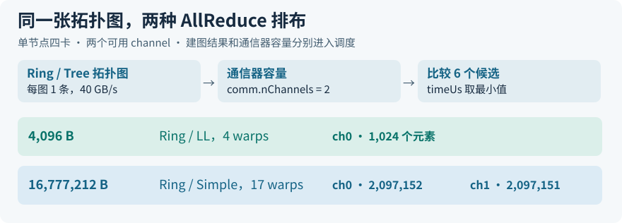

# 两个 channel 是怎么选出来的？

第 1、7、8 章固定两个 channel 来解释地址。现在倒回一次 FP32 SUM AllReduce，看同一套拓扑参数下，缩短消息后为什么只启动一个 channel。本章走一般 collective 调度路径。后三节的数字用分支源码函数体在 CPU 上复算，可以在仓库根目录运行 `python3 tools/zh_walkthrough/verify.py`。

## 初始化先回答「有哪些路径可走」

1. 初始化分别准备 Ring、Tree 等图，给定 pattern、允许的通道数上下限，再调用拓扑搜索。SM90 单机的候选速率按 60、50、40、30、24、20、15、12、11、6、3 递减，单位 GB/s。数组下标不直接等于 GPU 型号或 channel ID。[建图入口](../../src/init.cc#L1450) · [速率数组](../../src/graph/search.cc#L1199)
2. 取 `system->maxBw`、`system->totalBw` 和当前图的 `maxGpuLoad`。某一档高于单路径上限，或这一档乘最重 GPU 负载超过总上限，就跳到下一档，至多停在最后一档。譬如单独取上限 55、92，负载 2，60 超过 55，50×2 超过 92，40 是第一个送入搜索的档位。这个例子只演算初筛。[路径上限](../../src/graph/search.cc#L39) · [负载计算](../../src/graph/search.cc#L952) · [两项判断](../../src/graph/search.cc#L1342)
3. 搜索按候选 GPU、链路和剩余带宽试排顺序，试走时扣容量，回溯时恢复。比较已找到的图时检查最少通道等约束；常规比较使用 `nChannels * bwIntra`，相同 pattern 和 crossNic 的同带宽方案还比较跳数。后段搜索能提高已有方案的速率，部分图找不到路径还会走保底分支。所以初筛出来的 40 不能直接当作最终拓扑输出。[路径回溯](../../src/graph/search.cc#L360) · [比较](../../src/graph/search.cc#L448) · [再次搜索与保底](../../src/graph/search.cc#L1432)
4. 各 rank 交换图参数并对齐，`ncclTopoPostset` 连接 Ring 和双树，复制通道并按平台、通信器上下限等调整。性能模型读 `comm->graphs[algo].nChannels`，任务容量读 `comm->nChannels`。它们来自不同阶段，数值可以不同。[交换与对齐](../../src/init.cc#L1750) · [连接与复制](../../src/graph/connect.cc#L479) · [上下限](../../src/graph/connect.cc#L525)

## 谁决定哪一种算法和协议可以参加比较？

|阶段|输入和判断|后续使用者|
|---|---|---|
|收集任务|默认调度先处理适用的对称内核任务，再按 func、op、datatype 等组织一般任务。同类且规模接近的任务可聚合估价，`numPipeOps` 传入每通道预计任务数，即向上取整的 planner.nTasksColl/comm.nChannels。|对聚合任务调用 ncclGetAlgoInfo。[任务分组](../../src/enqueue/enqueue.cc#L485) · [聚合上界](../../src/enqueue/enqueue.cc#L514)|
|确定菜单|一般算法从 general mask 起步。没有被全局配置强制时，调用级 algSelection 可缩小范围。偏好集无解时重试完整菜单，软偏好可回退，强制偏好无解则返回 ncclInvalidArgument。|每一位指定一种可枚举 tuning。[构造输入](../../src/enqueue/enqueue.cc#L2224) · [失败与回退](../../src/enqueue/enqueue.cc#L2254)|
|模型及能力过滤|modelMap 把函数映射到实现。普通 Tree 支持 AllReduce；Ring 支持五种传统 collective。默认 LL128 检查节点内外路径、计算能力等，CollNet 和 NVLS 还要求相应支持。|保留允许且 valid 的候选，按候选各自模型估价。[模型表](../../src/tuning/cost_model.cc#L244) · [LL128 条件](../../src/tuning/cost_model.cc#L125) · [枚举](../../src/tuning/tuning.cc#L126)|
|比较|对有效候选，正的 selectionTimeUs 优先，否则使用 timeUs，严格小于才替换当前赢家。启用 tuner 插件时还有成本表和通道上限接口。|bestTuning 回写 algorithm、protocol、nWarps 与 nMaxChannels。[选择循环](../../src/tuning/tuning.cc#L153) · [插件](../../src/tuning/tuning.cc#L209) · [回写](../../src/enqueue/enqueue.cc#L2284)|

`NCCL_ENQUEUE_REARCH_ENABLE` 默认值为 0。启用另一套 enqueue 路径时，从 task_prep 的阶段入口和 post-tuning 排布继续追踪。[开关](../../src/enqueue/enqueue.cc#L35) · [入口](../../src/enqueue/task_prep/task_prep.cc#L11) · [排布](../../src/enqueue/task_prep/task_posttuning.cc#L542)

## 让六个候选计算同一笔账

固定输入：单节点 4 ranks、SM90、FP32 SUM、节点内 PATH_NVL、BALANCED_TREE。Ring 和 Tree 的图均给 1 个拓扑通道、40 GB/s 的节点内带宽、零节点间附加延迟。通信器给 2 个可用 channel，单任务、空计划、`numPipeOps=1`，采用源码默认模型常数和线程阈值。CPU 算例直接传入这两张图和六个候选，没有安装 tuner 插件。这是条件算例，换图或换候选集可以重现不同选择。

|候选|4,096 B 模型时间（µs）|16,777,212 B 模型时间（µs）|
|---|---:|---:|
|Tree / LL|11.608|4341.474|
|Tree / LL128|21.858|1324.079|
|Tree / Simple|32.647|1172.156|
|Ring / LL|**10.507**|1268.491|
|Ring / LL128|25.567|711.117|
|Ring / Simple|28.954|**657.945**|

以大消息的 Ring/Simple 为例，四卡 AllReduce 有 6 个带发送的 Ring 步骤。模型把总线带宽折成算法带宽 `1 × 40 × 4 / 6 = 26.6667 GB/s`，启动与链路延迟相加得到 `8.4 + 6 × 3.4 = 28.8 µs`。代入 `28.8 + 16,777,212 / (1000 × 26.6667)` 得 657.945 µs。小消息 Ring/LL 的算法带宽为 `min(141, 40 × 0.5) × 4 / 6 = 13.3333 GB/s`，延迟为 `6.6 + 6 × 0.6 = 10.2 µs`，4,096 B 时得到 10.507 µs。LL128 模型中的 0.92 是性能折算系数，线路实际数据与标志位布局见第 8 章。Tree 另有按大小索引的修正表。[Ring 模型](../../src/tuning/ring.cc#L38) · [Tree 模型](../../src/tuning/tree.cc#L30) · [微秒公式](../../src/tuning/tuning_general.cc#L58) · [协议布局](08-ring-protocols.md)

## 胜出的候选怎样变成 GPU 真正执行的范围？

|变量及单位|4,096 B 的赢家|16,777,212 B 的赢家|
|---|---:|---:|
|algorithm / protocol|Ring / LL|Ring / Simple|
|nc 起点，通信器可用通道|2|2|
|nt 起点，线程；threadThreshold|512；32|512；64|
|按大小缩减后的 nc；最终 nWarps|1；4|2；17|
|调度 trafficBytes，字节|32,768|33,554,424|
|countLo / countHi，FP32 元素|1,024 / 0|2,097,152 / 2,097,151|
|空计划中覆盖的 FP32 下标，半开区间|ch0 [0, 1,024)|ch0 [0, 2,097,152)，ch1 [2,097,152, 4,194,303)|

小消息先比较 `4096 < 2×512×32`，nc 减到 1。再把线程减到 256、128，等于 `1×128×32` 时停止，得到 4 个 warp。大消息超过 `2×512×64`，两个通道保留。Ring/Simple 另加 32 个同步线程，544 个线程等于 17 个 warp。[通道和线程循环](../../src/tuning/tuning_general.cc#L149)

最后还有一次排布。大小估价用的 nBytes 表示用户消息字节；调度用 trafficBytes 表示各任务在计划里占的权重，AllReduce 权重为 2，LL 再乘 4。调度器按各类任务的总流量和通道预算分 cell，再计算 countLo/Mid/Hi。一个 task 可受拥挤的计划、预算或 CTAs 限制影响。最终 `channelLo..channelHi` 装入设备 work，`plan->channelMask` 合并各 work 的通道位，普通设备 kernel 的 grid 为置位数，线程数取计划所需最大值。一个通信器内有多个任务时，读此 mask 才能知道整次 launch 用了多少块。[LL 权重](../../src/enqueue/enqueue.cc#L552) · [通道预算](../../src/enqueue/enqueue.cc#L692) · [分 cell](../../src/enqueue/enqueue.cc#L755) · [合并 mask](../../src/enqueue/enqueue.cc#L878) · [launch](../../src/enqueue/enqueue.cc#L1950) · [从元素追到末片](01-data-layout.md)
