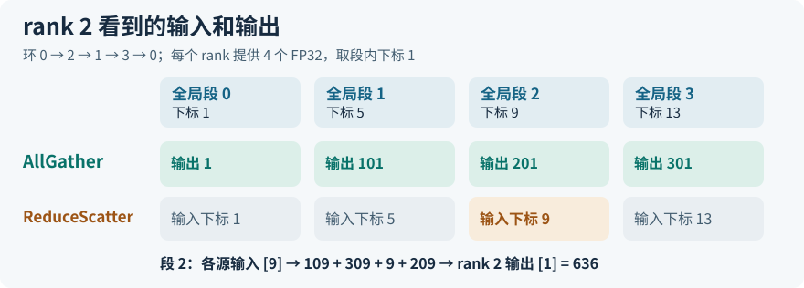

# 同一个 rank 在五种 Ring 操作里读写哪个地址？

取单个 channel 的环 **0 → 2 → 1 → 3 → 0**。观察全局 rank 2，它的前驱是 0，后继是 1，本地旋转后的 `ring->userRanks[] = {2,1,3,0}`。AllReduce 所用的 `ring->index` 是相对 rank 0 的环位置，这里为 1。AllGather、ReduceScatter 按全局 rank 编号排用户缓冲区，其他 rank 走不同的本地轮次，最终布局一致。[环索引初始化](../../src/init.cc#L1000) · [AllReduce 取环位置](../../src/device/all_reduce.h#L14) · [AllGather 取全局编号](../../src/device/all_gather.h#L16)

## 先固定一个可以核对的元素

令每个 rank 的输入为 `S_r[k] = 100*r + k`，选择 SUM，每个 rank 段长 c=4 个 FP32，观察段内元素 d=1。下文地址写作 FP32 下标，例如下标 9 对应指针基址加 36 字节。AllGather、Broadcast 在 host 把任务换成 int8 并换算 count，故下表的 FP32 地址还原到这两种实际设备 work 时须乘 4。观察单个元素不要求运行时把四个元素切成四条消息。[任务归一化](../../src/enqueue/enqueue.cc#L2999)

|操作|rank 2 从哪个用户缓冲区读|它自己的 recvbuff 能读到什么|
|---|---|---|
|Broadcast，root=1|消费上游传来的 root 输入|下标 1 得 101，所有 rank 相同|
|Reduce，root=1|本地 sendbuff[1]=201，和上游部分和相加再发送|最终输出属于 rank 1，其下标 1 得 604|
|AllGather|本地 sendbuff[1]=201，属于全局段 2|下标 1、5、9、13 分别得到 1、101、201、301|
|ReduceScatter|各源 rank 的 sendbuff 都有 16 个元素；rank 2 所属段的段内元素来自各源的下标 9|本 rank 的 recvbuff[1] 得 636|
|AllReduce|每个下标都对四份输入分别归约|各 rank 的 recvbuff[k] 都是 600+4k；例如下标 5 得 620|

### AllGather 与 ReduceScatter 逐跳对照

表中每一行是 rank 2 的一次本地原语。左栏的「段」表示输入来自哪个 rank；右栏的「段」表示最终归哪个 rank。GPU 原语一次实际处理连续的 nelem 个 T。

|rank 2 的调用次序|AllGather，固定 d=1|ReduceScatter，固定 d=1|
|---:|---|---|
|0|本地段 2，读 sendbuff[1]，写 recvbuff[9] 并发往 rank 1；原地输入已经在槽 9 时只发送|目的段 0，读 sendbuff[1]，发往 rank 1|
|1|段 0，从 rank 0 接收，写 recvbuff[1] 并转发|目的段 3，接收部分和，加 sendbuff[13]，转发|
|2|段 3，接收，写 recvbuff[13] 并转发|目的段 1，接收部分和，加 sendbuff[5]，转发|
|3|段 1，接收，写 recvbuff[5]，此段在本 rank 结束|本地段 2，接收部分和，加 sendbuff[9]，写短输出 recvbuff[1]|

例如 ReduceScatter 的段 2 从 rank 1 开始，按 **1 → 3 → 0 → 2** 传输。在下标 9 上，109 发给 rank 3，加 309 得 418；rank 0 加 9 得 427；rank 2 加 209 得 **636**，写出的地址从长输入的下标 9 变成短输出的下标 1。另三个 rank 同时推进其他目的段。[AllGather 的四步](../../src/device/all_gather.h#L49) · [ReduceScatter 的四步](../../src/device/reduce_scatter.h#L38)

### Broadcast、Reduce 和 AllReduce 在哪一跳结束？

- **Broadcast，root=1。** 从 1 发给 3，3 和 0 边写边转发，2 发现自己的 nextRank 等于 root，执行末次接收。Root 在 sendbuff 与 recvbuff 分开时也会把自己的结果写进 recvbuff。[root 和末跳分支](../../src/device/broadcast.h#L44)
- **Reduce，root=1。** root 的后继 3 先发送 301，rank 0 加 1，rank 2 加 201，rank 1 收到 503 再加 101，写 recvbuff[1]=604。判定起点用 prevRank==root，判定写最终输出用 rank==root。[三类角色](../../src/device/reduce.h#L34)
- **AllReduce。** 用一圈四块 C0…C3、每块 4 个 FP32 举例。rank 2 的环位置是 1，它在七次本地调用中依次发送 C0；归约转发 C3、C2；归约写出并转发 C1；复制转发 C0、C3；最后收 C2。C1 含下标 5，这个元素沿 **1 → 3 → 0 → 2** 归约为 105+305+5+205=620，随后 **2 → 1 → 3 → 0** 分发最终值。每个 rank 有七次本地调用，其中六次带发送，流水中邻居的发送和接收相互配对。[七次调用](../../src/device/all_reduce.h#L40) · [完整末圈](08-ring-protocols.md)

## 从原语名称读懂缓冲区角色

|实际原语举例|上游输入|本地输入|本地输出|发下一跳|
|---|---|---|---|---|
|send / directSend|—|读|—|是|
|directCopySend|—|读|写|是|
|directRecv|收|—|写|—|
|directRecvCopyDirectSend|收|—|写|是|
|recvReduceSend / directRecvReduceDirectSend|收|参与归约|—|是|
|recvReduceCopy|收|参与归约|写|—|
|directRecvReduceCopyDirectSend|收|参与归约|写|是|

表中「发」和「收」描述数据依赖。Simple 原语用模板参数向 genericOp 指明接收、发送、输入缓冲和输出缓冲；实际读写还受连接的 direct 能力、是否注册、是否原地等影响。LL/LL128 的 FIFO 行与同步语义见第 8 章。[Simple 原语到 genericOp](../../src/device/prims_simple.h#L940) · [Ring 协议](08-ring-protocols.md)
