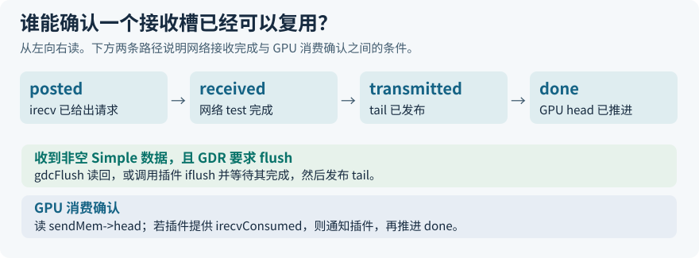

# 从 kernel plan 到可复用的网络缓冲，再到通信器释放

同一个跨节点 AllReduce，有三种不同的「完成」值得在调试时分开观察：NIC 完成一个请求、GPU 消费了一个 FIFO 槽、整个 CUDA stream 上的 collective 完成。三者拥有不同的对象和通知机制。以下以一般计划和内置 NET/IB 为例。

## CUDA Graph 捕获改变了谁持有计划

|时刻|普通提交|CUDA Graph 捕获|
|---|---|---|
|建计划|workStorageType 初选 Fifo。每个 kernel 对 FIFO 的外部 work 预算至多其一半。|plan->persistent 为真，初选 Persistent，外部预算使用捕获路径的上限。|
|装入 work|若参数空间能同时容纳 batch 和 work，则直接嵌入 Args；其余 work 用循环 FIFO，重用前检查空间。|小 work 同样可进 Args；超出参数空间的 work 使用可跨 replay 存活的设备存储。|
|启动前|uploadWork 按实际存储类型设置 workBuf 和偏移。一般 kernel 的 grid.x 是 channelMask 的置位数，block.x 来自 threadPerBlock。|图记录 launch 和必要的 host/proxy 操作；对持久计划加引用并把 destructor 注册到捕获图。|
|何时回收|host 路径把可回收 plan 交给 callbackQueue。FIFO 的生产和消费位置单独维护。|graph 释放相应用户对象时，persistentDestructor 将计划交回 callbackQueue，reclaimPlan 减引用并按存储类型清理；一次 replay 返回后仍可再次执行。|

源码定位：[最初选择](../../src/enqueue/enqueue.cc#L1758) · [预算](../../src/enqueue/enqueue.cc#L1798) · [改用 Args 的条件](../../src/enqueue/enqueue.cc#L245) · [三种上传分支](../../src/enqueue/enqueue.cc#L1400) · [注册析构](../../src/enqueue/enqueue.cc#L1919) · [回收](../../src/enqueue/enqueue.cc#L1624) · [grid](../../src/enqueue/enqueue.cc#L1950)

## 一份网络请求怎样走完收发两端？

|位置|计数器推进条件|完成这一步以后谁能行动|
|---|---|---|
|发送方 posted|有空槽且不超过 maxDepth，按 sliceSteps 预留下一次工作|GPU 可生产这一段待发数据|
|发送方 transmitted|上游已经生产、协议就绪条件满足；isend 返回有效 request|网络插件推进该次请求，后续调用 test|
|发送方 done|网络 test 报完成，按分支更新发送侧可复用进度|后续步骤可重新使用对应发送资源|
|接收方 posted|准备好地址、大小、tag、MR 句柄，irecv 成功给出请求；支持时多个 sub 可合并|网络可写入本地目的范围|
|接收方 received|test 报接收完成并给出各 sub 的实际字节数|按协议和资源特性检查 GPU 可见性|
|接收方 transmitted|必要的 flush 已完成；发布接收端 tail|GPU 原语可以消费这一段|
|接收方 done|观察本地 GPU 推进的 sendMem->head；若插件提供 irecvConsumed，再通知插件|槽位可回收；sub 达到 nsteps 后退出此操作|

`sub->base` 是连接上本次操作的起点；posted/received/transmitted/done 是相对 step 进度，每次可加 `sliceSteps`。例如 base=8、NCCL_STEPS=8，接收进度从 0 开始，首个数据槽为 (8+0)%8=0；发布 tail 时仍使用绝对进度。环形下标绕回零后，绝对进度能区别两次对同一槽的访问。[发送状态机](../../src/transport/net.cc#L1327) · [提交 isend](../../src/transport/net.cc#L1440) · [接收 irecv](../../src/transport/net.cc#L1622) · [接收 test](../../src/transport/net.cc#L1650) · [发布 tail](../../src/transport/net.cc#L1734) · [消费确认](../../src/transport/net.cc#L1755)

接收侧只有在总字节数大于零、协议为 Simple 且 GDR 资源要求 flush 时才进入相应分支。有 gdcFlush 时执行规定的读回路径；否则调用插件 iflush，异步请求还需 test。内置 IB 的 test 会轮询 CQ。看见 CQE 后，若问题是「GPU 何时读到这个槽」，下一处应看 flush 和 tail；若问题是「槽何时可重用」，再看 GPU 的 head。[flush 条件与实现](../../src/transport/net.cc#L1661) · [IB flush](../../src/transport/net_ib/p2p.cc#L571) · [轮询 CQ](../../src/transport/net_ib/p2p.cc#L926)

## 一条连接上的 4 个 QP 怎样分一笔 1,000 B 的请求？

固定一个有方向的 sendComm/recvComm，两端各 1 个物理设备，QPS_PER_CONNECTION=4，两端协商结果均为 4，不计可选 flush 等附加资源。建立阶段先按本地和远端设备数、QP 配置算 nqps，在两端创建匹配的数据 QP。请求阶段另行读取 splitDataOnQps 选择本请求使用的数量。[建立](../../src/transport/net_ib/connect.cc#L966) · [创建发送端 QP](../../src/transport/net_ib/connect.cc#L733) · [请求选择](../../src/transport/net_ib/common.h#L450)

|条件|给这笔请求的 QP 数|该请求各数据片的字节数|
|---|---:|---|
|splitDataOnQps=0，nDataQps=1|1|1,000。后续请求根据 id 轮换可用 QP。|
|splitDataOnQps=1，nqps=4|4|256、256、256、232。单设备权重为 100%，每片理想值 250 B，向上对齐 128 B，再裁到剩余字节。|

每个 WR 用当前设备相应 MR 的 lkey 和对端的 rkey。注册逻辑按设备查注册缓存，覆盖请求页范围时可增 refs 并复用 MR；每个使用该范围的 QP 仍可取得相同的 key。释放句柄时减少引用，最后一个引用才注销该条缓存里的 MR。因此仅改变这条连接的 QP 数，无法据此按相同比例增加用户缓冲区的 MR 预算。双向连接、多设备、控制缓冲和可选 flush 各有独立的资源来源。[分片公式](../../src/transport/net_ib/p2p.cc#L179) · [QP 轮换](../../src/transport/net_ib/common.h#L479) · [注册](../../src/transport/net_ib/reg.cc#L10) · [注销](../../src/transport/net_ib/reg.cc#L102)

## 谁负责整个 communicator 的收尾？

ncclCommFinalize 检查通信器就绪和重复 finalize，提交 commDestroySync 工作。它切换到该通信器的 GPU、同步内部 stream，并处理相关引用和回调。ncclCommDestroy 提交 commReclaim。共享同一进程内通信器组的 rank 通过计数协调，最后到达的处理该组尚未完成的同步、停止相应服务并清理各通信器。调某个 collective 的数据依赖时要回到用户 CUDA stream 和对应的事件；调 graph 销毁后的资源滞留时看 persistentRefs 和 callbackQueue；调 communicator 整体退出则看 commReclaim。[Finalize](../../src/init.cc#L3323) · [同步](../../src/init.cc#L3239) · [Destroy](../../src/init.cc#L3450) · [组内回收](../../src/init.cc#L3374)
