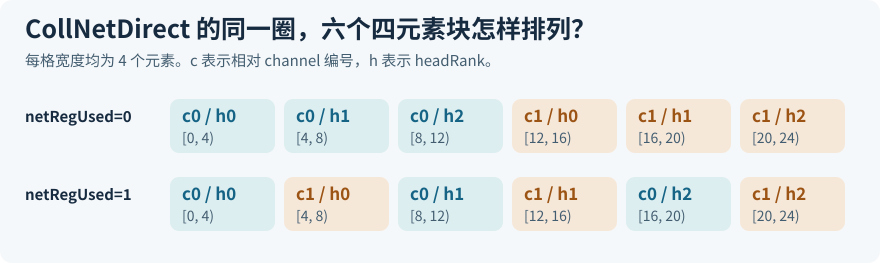

# 换成 CollNet、NVLS 或 PAT，地址公式怎么变？

前几章的四卡 Ring 用环位置分 chunk，双树则让一个通道的整段沿一棵树归约。现在换设备算法：先从函数和协议确定实际特化，再检查决定下标的字段。以下 GPU 地址公式都以模板元素 T 为单位。

|算法、协议|一般模型表允许的传统 collective|决定下标或下一次通信的对象|
|---|---|---|
|CollNetDirect / Simple|AllReduce、AllGather、ReduceScatter|channel 内的 collnetDirect、headRank、工作中的 netRegUsed|
|CollNetChain / Simple|AllReduce|collnetChain 的 up/down 以及沿链不同方向的线程分工|
|NVLS / Simple|AllReduce、AllGather、ReduceScatter|nvls.nHeads、headRank、oneNode、注册状态|
|NVLSTree / Simple|AllReduce|nvls.treeUp/treeDown、headRank、通道连续区间|
|PAT / Simple|AllGather、ReduceScatter|PAT 生成的 recvDim、sendDim、inpIx、outIx，以及本节点的 rank 数|

模型是否实际开放，还取决于通信器、数据类型、操作、拓扑和运行配置。设备函数入口和静态模型表可交叉核对。[模型表](../../src/tuning/cost_model.cc#L244) · [CollNetChain](../../src/device/all_reduce.h#L638) · [NVLS 的 AllGather](../../src/device/all_gather.h#L274) · [NVLS 的 ReduceScatter](../../src/device/reduce_scatter.h#L233)

## CollNetDirect：同一组头节点，注册状态会改变布局

以 AllReduce 的 reduce 线程组为例，限定 hasDn 成立、direct->out 有效，当前 channel 的相对编号 `bid = channelId-channelLo`。循环每轮覆盖 `loopSize=nChannels*nHeads*chunkSize` 个元素。下面固定 nChannels=2、nHeads=3、chunkSize=4，第一轮 gridOffset=0。总计 24 个元素，六个组合都可分别定位。

|bid / headRank|netRegUsed=0 的起点|netRegUsed=1 的起点|
|---|---:|---:|
|0 / 0|0|0|
|0 / 1|4|8|
|0 / 2|8|16|
|1 / 0|12|4|
|1 / 1|16|12|
|1 / 2|20|20|

普通布局按 `(bid*nHeads+headRank)*chunkSize`，注册用户缓冲路径按 `(bid+headRank*nChannels)*chunkSize`。例如 bid=1、headRank=0 的 4 个元素由 [12,16) 变为 [4,8)。scatter 线程同步改变 offsetBase 和 peerOffset；跟网络端对照时应采用同一组 netRegUsed 条件。下一轮在上述下标上统一加 24，最后一片由剩余 size 裁短。[线程分组](../../src/device/all_reduce.h#L248) · [scatter 地址](../../src/device/all_reduce.h#L278) · [reduce 地址](../../src/device/all_reduce.h#L296)

## NVLS：先找本通道区间，再找 head 的块

单节点 NVLS AllReduce 先调用 ncclCollCbdPart 获取 gridOffset、channelCount、chunkSize。一个满圈覆盖 `nHeads*chunkSize`，head 的偏移为 `gridOffset+elemOffset+headRank*chunkSize`。例如通道从 64 开始，nHeads=2、chunkSize=4、channelCount=16，head 1 处理 [68,72) 和 [76,80)。scatter/gather 线程组与 head 的归约线程组在同一算法中承担不同工作，注册路径还改变本地搬运。尾圈需先按源码重算 chunkSize：这里单节点 NVLS 特化传 16384 字节对齐；NVLSTree 特化传 16 字节，跨树方向还要看 treeUp、treeDown 和线程角色。[单节点 NVLS](../../src/device/all_reduce.h#L410) · [head 下标](../../src/device/all_reduce.h#L451) · [NVLSTree](../../src/device/all_reduce.h#L527)

## PAT：相同的四个 rank，通过 step 描述符选择不同方向

默认 PAT_ENABLE=2 时，至少需要 SM60；多 rank/节点要求多节点和可用 NVLS，默认还要求 host 类型的网络设备。one-RPN 指每节点一个 rank。该情况下，专用线程算出一条 ncclPatStep，工作线程按描述符执行 patCopy 或 patReduce，再释放共享槽。描述符里的 recvDim/sendDim 是维度，负值表示这个方向没有网络 peer；inpIx/outIx 是输入/输出元素下标，具体是否读写取决于角色。postRecv/postSend 决定何时向 peer 发布进度；last=2 表示生成器结束。[启用条件](../../src/tuning/pat.cc#L15) · [描述符](../../src/include/collectives.h#L372) · [生成与执行](../../src/device/all_gather.h#L146) · [接收、发送角色](../../src/device/prims_simple.h#L1302)

沿用第 10 章的全局 rank 2、每段 4 个 FP32、段内下标 1。这里改为四节点、每节点一 rank，给调度生成器通道区间 [1,2)、chunkCount=1、stepSize=4 B、stepDepth=8。下表是直接运行本版 PatAGAlgorithm 和 PatRSAlgorithm 的 host 函数所得到的有效步骤，维度和下标按生成顺序列出。表中 — 表示维度为 -1。

|次序|AG 收维度 → 发维度|AG inpIx / outIx|RS 收维度 → 发维度|RS inpIx / outIx|
|---:|---|---|---|---|
|0|— → 1|1 / 9|— → 0|5 / 0|
|1|— → 0|1 / 9|— → 0|13 / 0|
|2|1 → 0|1 / 1|0 → 1|1 / 1|
|3|0 → —|0 / 13|1 → —|9 / 1|
|4|0 → —|0 / 5|0 → —|9 / 1|

例如 AG 的次序 3、4 都只有接收维度，此时 outIx=13、5 对应全局段 3 和 1；两个操作的 inpIx 字段为 0 不意味着要从用户输入的第 0 个元素发送。RS 最后的 outIx=1 仍是短输出中的位置。检查程序覆盖 2–8 ranks、所有 rank、两种区间，共 140 条生成器轨迹，包含非 2 的幂和尾块。[AG 生成](../../src/include/collectives.h#L796) · [RS 生成](../../src/include/collectives.h#L522) · [RS 工作线程](../../src/device/reduce_scatter.h#L111)

每节点多个 rank 时，PAT 调度器接收的身份改成 node/nNodes，段距改为 `patCount=count*localRanks`；例如两节点、每节点四 rank、count=4，则此处段距为 16。AllGather 同时有本地 NVLS gather 工作组，ReduceScatter 则先通过本地 NVLS 归约组供给跨节点 PAT 工作者。按单 rank/节点的 peer 表推算这一分支会漏掉本地阶段。[AG 多 rank/节点](../../src/device/all_gather.h#L189) · [RS 多 rank/节点](../../src/device/reduce_scatter.h#L154)

## 2.32.6 还有哪些入口会绕过上述一般执行路径？

|从用户侧看到的入口|下一步读哪里|需要跟踪的数据|
|---|---|---|
|符合对称窗口和策略条件的 collective|常规入队前检查 CE 可用性、调用策略与大小；另有 symmetric kernel 预处理。[CE 判断](../../src/enqueue/enqueue.cc#L3463) · [sym 任务预处理](../../src/enqueue/enqueue.cc#L485)|窗口是否已注册、CTA policy、候选算法、通信器和消息大小|
|ncclPutSignal / ncclSignal|API 构造请求，进入 host RMA 的窗口、初始化和 peer 参数检查，再按后端排队。[PutSignal](../../src/collectives.cc#L425) · [校验](../../src/enqueue/enqueue.cc#L3036) · [代理描述符](../../src/rma/rma_proxy_launch.cc#L29)|窗口内偏移、目的 peer、signal、ctx|
|设备侧 GIN|从通信器建立后端连接，按 backend 管理监听、连接与进度。[连接](../../src/gin/gin_host.cc#L93) · [进度线程](../../src/gin/gin_host.cc#L57)|GIN backend、device communicator、连接上下文|

完整的普通执行链可从[拓扑和选型](09-tuning.md)走到[五种 collective 的用户地址](10-ring-addresses.md)，再到[网络完成和资源回收](11-completion.md)。
